# Cardinal 3D 0.77 — illustrated manual

Build a modular instrument around you. Cardinal 3D runs Cardinal's synthesizer inside a Windows VR application, using a Quest 2 through Quest Link. Several physical cases share one patch, so cables can connect modules across cases.

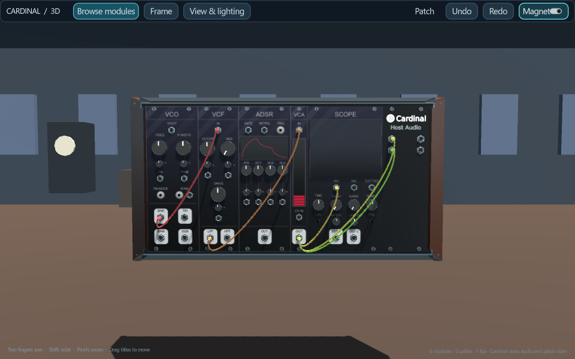

## 1. Install and start

Download the Windows x64 ZIP from [Releases](https://github.com/mtyas/Cardinal-3D/releases), extract the whole folder, and keep its files together. No Python, Docker or compiler is needed to play. Install Meta Horizon Link, connect the Quest 2 with a USB data cable, and enter Quest Link from the headset. Make Meta's runtime the active OpenXR runtime in the Link app if another PC VR runtime is selected.

Run **Launch Quest Link.bat**. For a monitor-only check, use **Launch desktop.bat**. Close the old app before starting another copy. Start with a low volume; the starter patch makes a continuous tone. The startup guide can be skipped and replayed from the B menu. Its startup toggle remembers your choice.

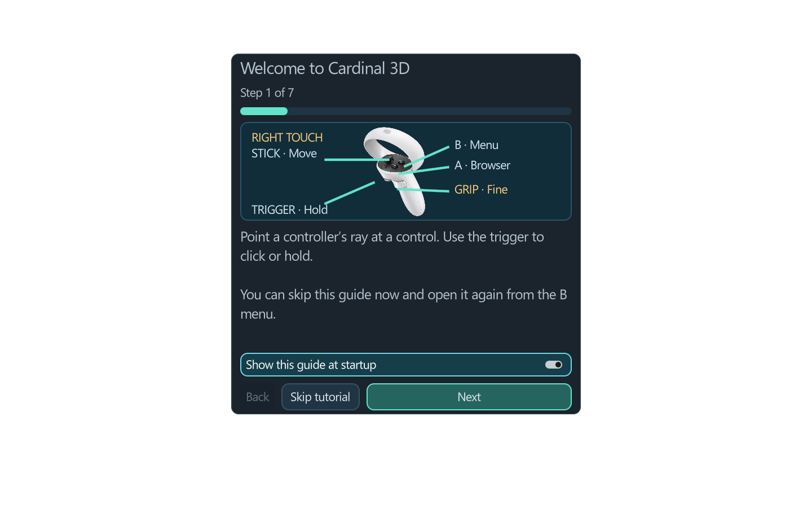

Your computer needs Windows x64, a graphics card supported by Quest Link and the Meta Link software. The tested setup is Quest 2 over USB; other OpenXR headsets and Air Link are not validated. This is a PC application, not a standalone Android headset app or a DAW plugin.

## 2. Know the controls

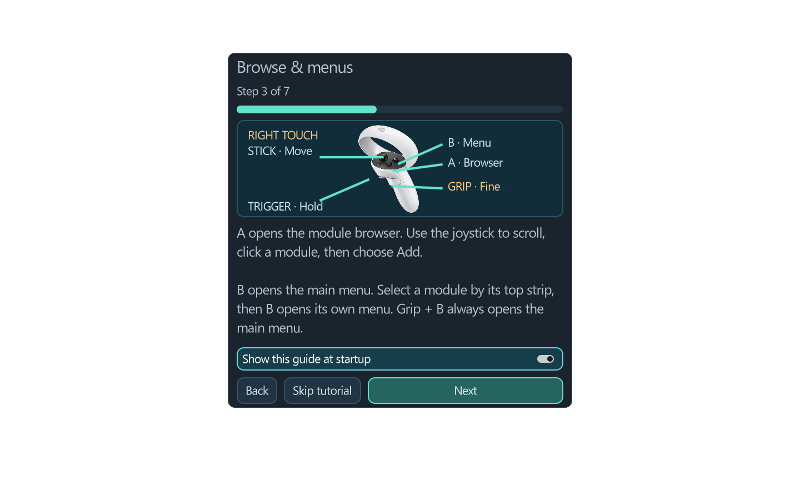

| Control | Action |
|---|---|
| Trigger | Click; hold to adjust a control, patch a cable or drag a title/case |
| Right A / left X | Open or close the module browser |
| Right B / left Y | Main menu; selected module's native menu when a module is selected |
| Grip + B/Y | Always open the main menu |
| Joystick | Pan left/right and move closer/farther; scroll when a menu/browser is open |
| Grip + joystick | Raise/lower your viewpoint; turn left/right around your head |
| Trigger + wrist twist | Turn a knob or move a fader |
| Trigger + grip + wrist twist | Ten times finer knob/fader adjustment |
| Trigger on a case edge, in Layout mode | Aim to position; twist wrist to rotate upright; stick up/down changes distance |

The Oculus/system button remains a headset control, not an app shortcut. The right-controller illustration is an original teaching render; A/X and B/Y are the corresponding shortcuts on either hand. Tracked hand pointing/pinching is available when the PC OpenXR runtime exposes it, but the controller grip shortcuts are controller actions.

## 3. Play knobs, faders and small selectors

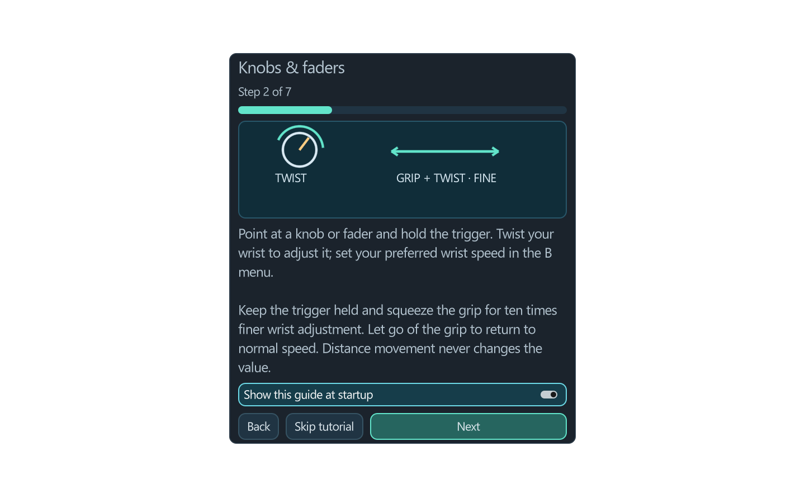

Point at a knob or fader, hold the trigger and twist your wrist. **Wrist speed** in the main menu sets the coarse sensitivity. High settings let a short twist sweep a large range; low settings make normal adjustment more precise. While the trigger stays held, squeeze the grip to use one-tenth that sensitivity. Release the grip to return to normal speed. Moving your controller closer or farther does not change the value. The floating indicator shows the current mode and the native parameter display.

Click switches and buttons with the trigger. In MixMaster, the small arrows beside the bottom channel group display change its routing. Click the number itself to open **Main output / Group** choices. Native module-specific widgets retain their original behaviour; not every custom display offers a generic knob-style interaction.

## 4. Find and add modules

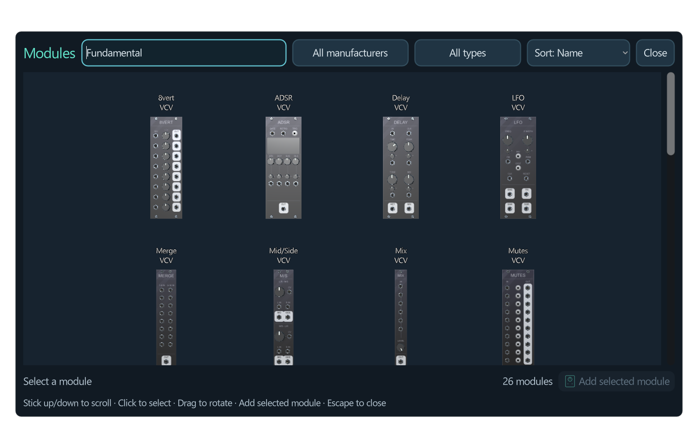

Press A/X. Use Search, Manufacturer and Type to narrow the list; filter choices use large buttons. The stick scrolls the module gallery or an open filter list. Click a preview; the highlight and selection text show what you chose. **Add selected module** inserts it and closes the browser. New modules go into the active rack and use native non-overlapping placement. Titles belong to the preview immediately underneath them.

To move a module, hold only its top title strip. A placement ghost shows the destination and neighbours that will slide aside. Release to commit the move. Selecting its title also makes B/Y open that module's native context menu, including its duplicate, delete and other available options. Use Undo for reversible patch edits.

## 5. Patch and unplug cables

Hold an output socket and release over an input socket to connect it. Aim at the socket itself; nearby compatible sockets are helped by the aiming target. To repatch, grab the plug on an input, pull it clear and release at another compatible socket. To unplug, pull the input plug clear and release away from sockets. Cancelling preserves the original cable. Cable replacements and removals use native undo history. Output fan-out is supported; inputs hold one cable.

## 6. Arrange multiple cases

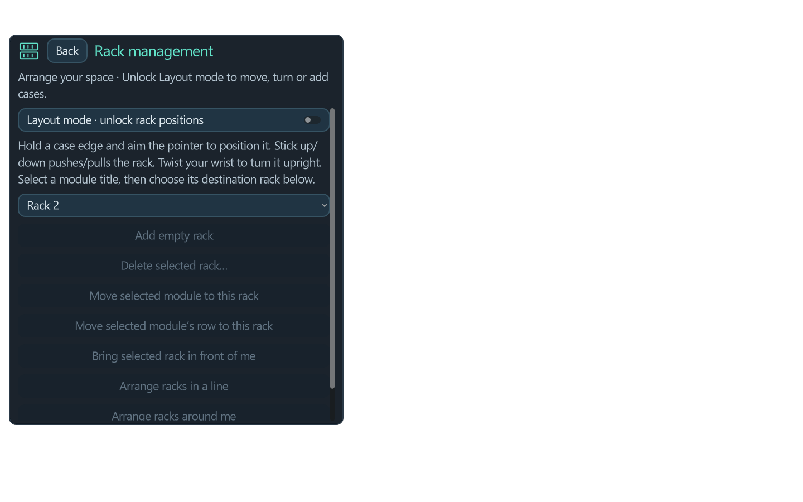

Open **B → Rack management**, then enable **Layout mode**. The selected rack is the destination for new modules and case actions. **Add empty rack** puts a new case beside it. Select a module title and use the transfer action to move that module or its row into the selected case. All cases remain part of the same patch and can be wired together.

Hold a case edge and aim the controller ray at the desired position. Aiming upward lifts the case without having to lift your hand high. Stick up/down changes its distance along the ray; moving your hand also moves the ray's origin. Twist your wrist to turn the case around the vertical axis. Cases never tilt or roll. Release to save the placement. Cable lines simplify during movement and return to detailed tubes on release.

Use the line, around-you and stack actions as starting arrangements, then refine by hand. Bring in front retrieves a distant case. Deleting a case asks for confirmation and reports its modules/cables. **Deletion removes its contents**; one Undo restores those contents, but does not restore the deleted physical case arrangement. The final case can be cleared. Turn Layout mode off before performing so case positions remain locked.

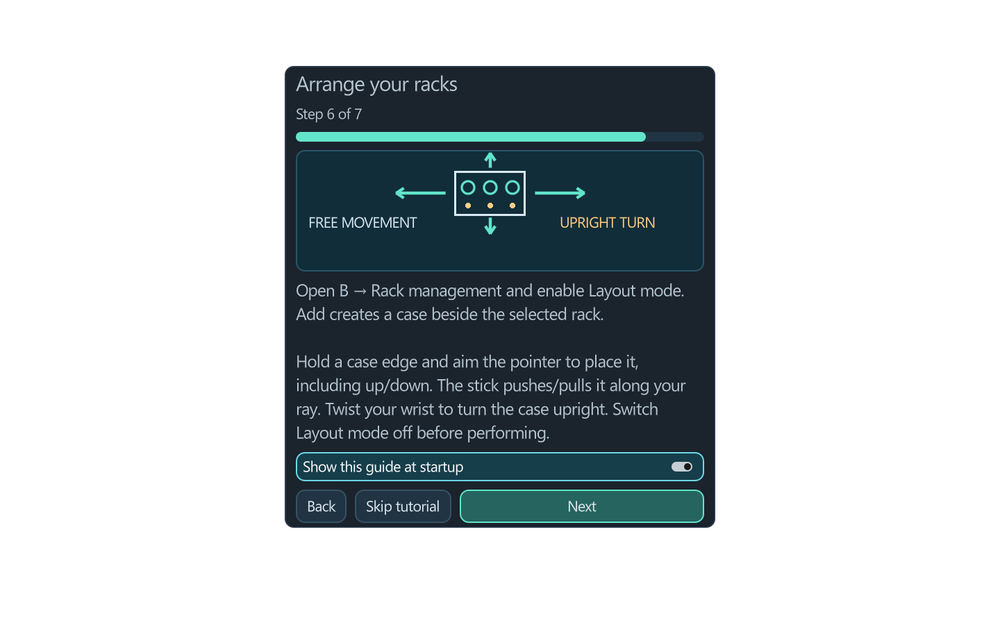

## 7. Choose a place and picture quality

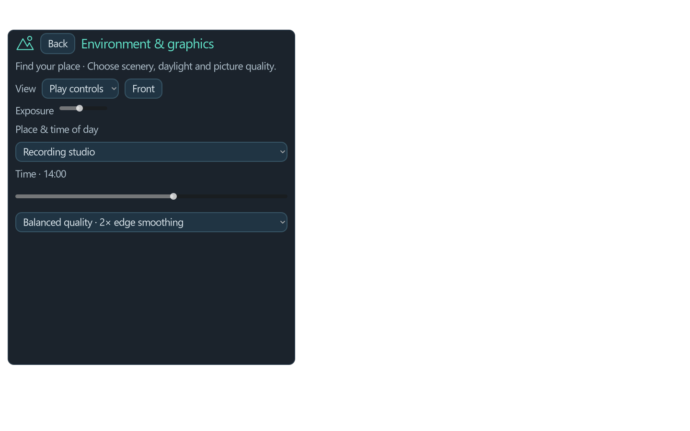

Choose Recording studio, Forest, Mountain summit, Stage, Warehouse, Desert or Flowery field. Time of day changes the lighting. These are lightweight stylized scenes. Balanced uses 2× MSAA; higher quality uses 4×; maximum speed reduces antialiasing. Try Balanced first and judge clarity and smoothness in your headset. GPU load depends on the patch, previews and PC; no universal latency guarantee is made.

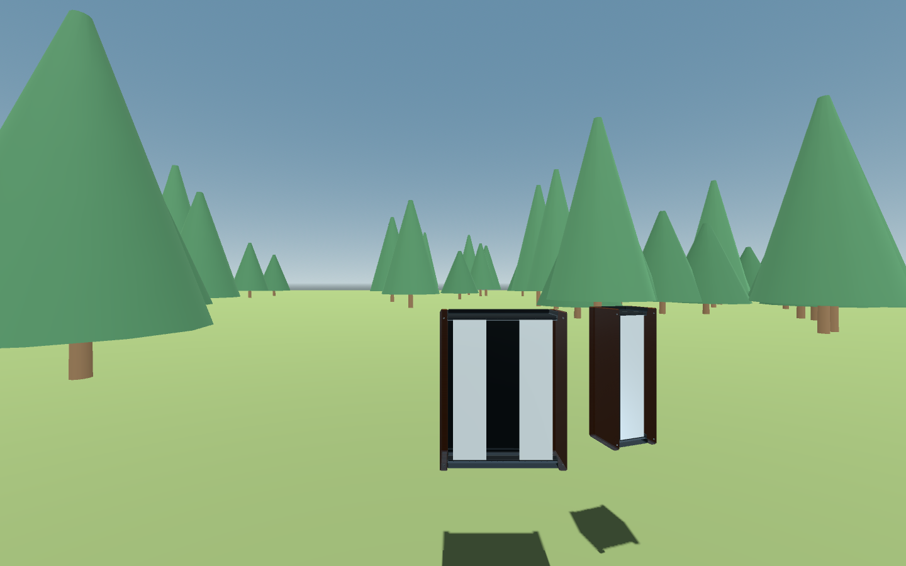

## 8. Audio, MIDI and saving

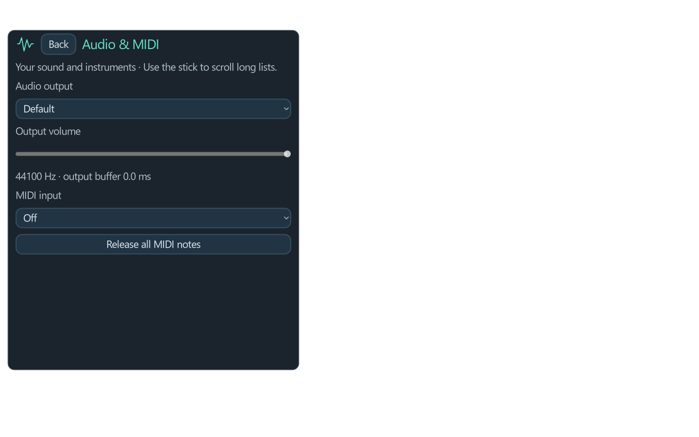

**Audio & MIDI devices** has its own page. Choose your output, set volume, choose a MIDI input and use note panic if notes get stuck. In long option lists, move the stick to highlight and press the trigger to confirm. Selecting a highlighted item commits the change. Audio input, full driver/channel/sample-rate/buffer controls, MIDI output and SysEx are not implemented in 0.77.

Use **Open patch** or **Save patch as** from the main menu. The .vcv patch remains native; the adjacent **.vcv.3d.json** stores the physical case arrangement. Keep both files together when moving or sharing a patch. The app also recovers the last patch periodically and when closing, with a previous .bak copy. Release downloads save settings/recovery under `%LOCALAPPDATA%\Cardinal-3D\0.77`; development launchers use their separate `standalone-user` folder. Recovery is not a substitute for saving your patch with a name.

## 9. About, support and licences

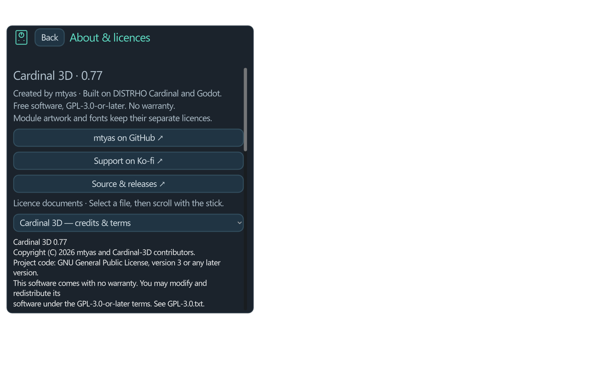

The About page links to [mtyas on GitHub](https://github.com/mtyas), [Ko-fi support](https://ko-fi.com/mtyas) and the project. Links open your Windows browser only when clicked. Support is optional; no account or network connection is needed to play.

Project code is **GPL-3.0-or-later**, with no warranty. Cardinal, Rack, Godot and module authors are credited in the shipped notices. Module panel artwork, fonts and samples retain their separate upstream terms, including noncommercial and custom restrictions. Consult **legal/NOTICE.txt**, **LICENSES.md**, **LICENSE-PERMISSIONS.md** and the individual notices before reusing artwork. The matching full source download contains recursive Cardinal modules, bindings and dependency source archives; GitHub's automatic ZIP alone is incomplete. Documentation screenshots depict the original module artwork and keep those asset terms.

## 10. If something goes wrong

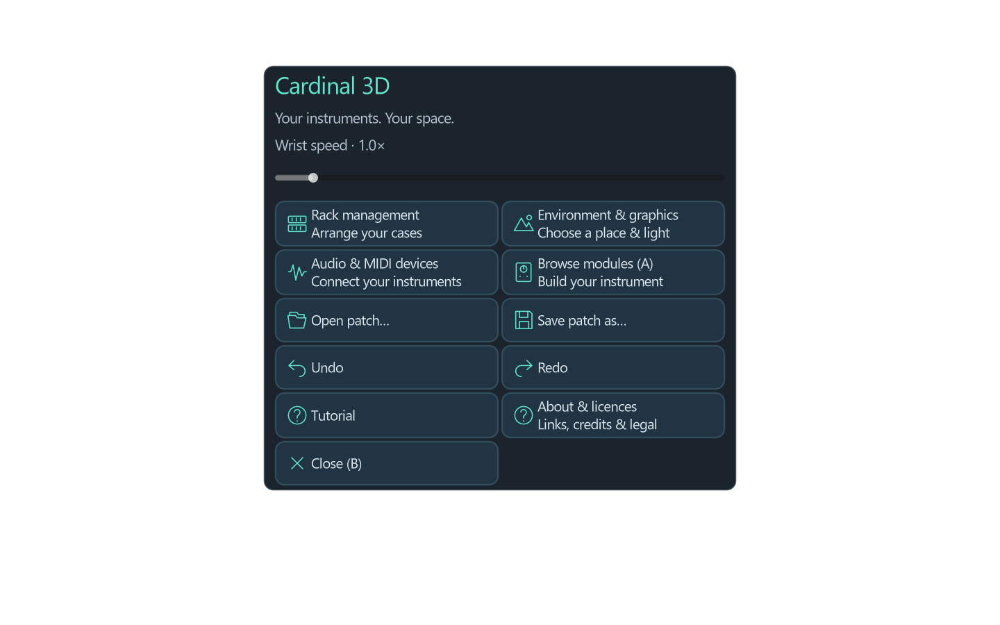

If VR does not appear, check the USB Quest Link session, active Meta OpenXR runtime and Link's PC compatibility first. If there is no sound, select the Quest virtual output in both the app and Windows where appropriate, check volume and the patch's Host Audio connections. If a rack is hard to reach, use grip + stick to move your viewpoint, or Bring in front in Layout mode. If menus scroll unexpectedly, return the stick to centre before clicking.

For a crash, retain `session.log` from the release settings folder and describe the patch/modules and last action in a [GitHub issue](https://github.com/mtyas/Cardinal-3D/issues). Remove private patch names or paths before posting logs. Private patches and settings are never part of the download. Keep the previous working release until you have tested a new one.
